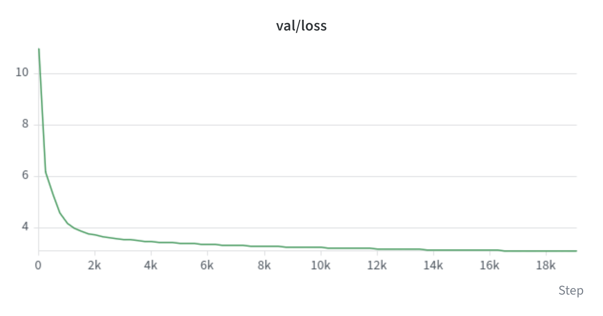
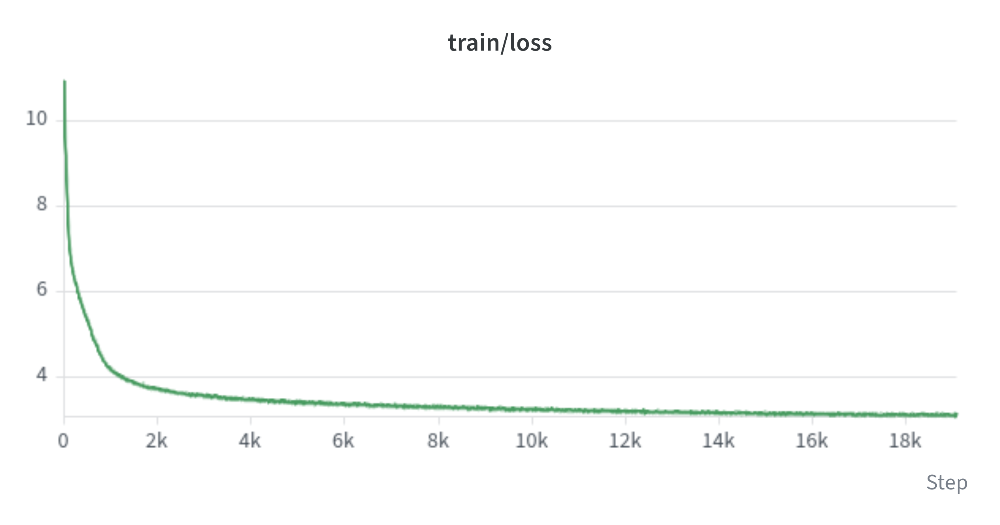
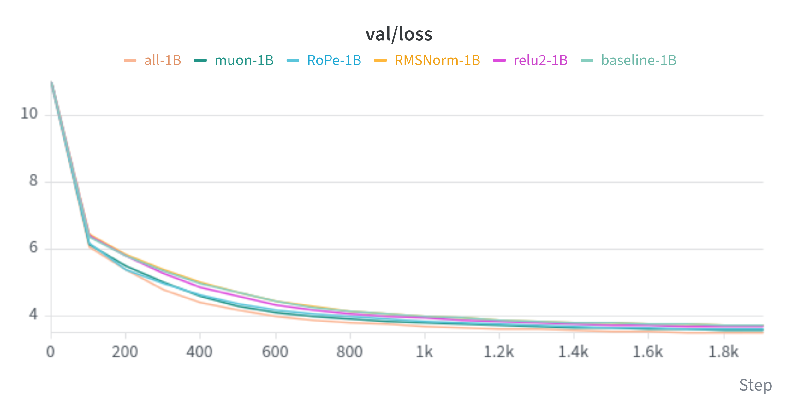
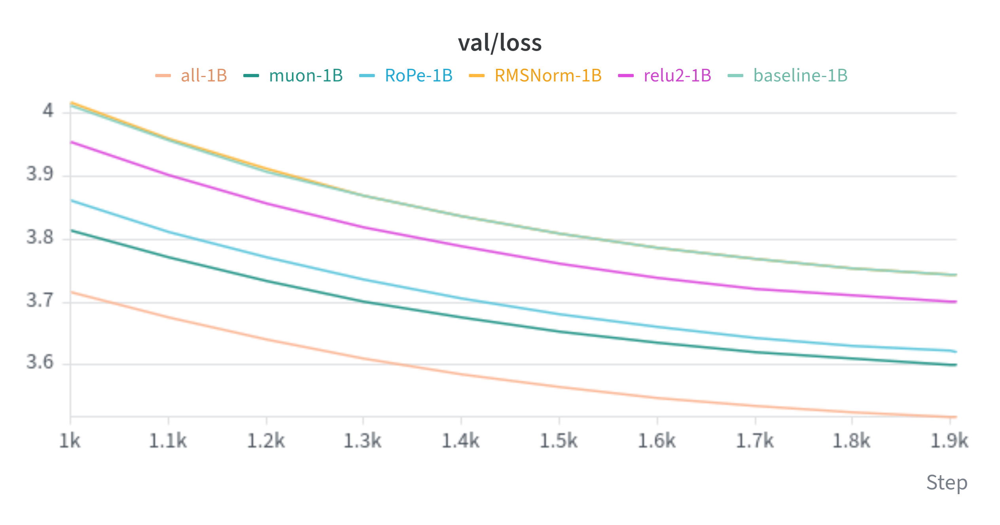

# GPT-2 (124M) from scratch in PyTorch: multi-GPU training and ablations on 2× RTX 3090

A from-scratch reproduction of GPT-2 small (124M parameters), trained on **10B tokens** on two consumer GPUs with DistributedDataParallel, followed by a controlled ablation study of four modern changes (RMSNorm, ReLU², RoPE, Muon).

> **Transparency note.** The baseline follows Andrej Karpathy's ["Let's reproduce GPT-2 (124M)"](https://www.youtube.com/watch?v=l8pRSuU81PU) tutorial: the model and training recipe are his. What I did on top of it was to re-engineer the code and make it run efficiently on my own hardware, then to implement and evaluate the modern changes listed above myself.

## Results

### Baseline: 10B tokens

| | |
|---|---|
| Model | GPT-2 small, 124M parameters (12 layers, 12 heads, d=768, context 1024) |
| Training data | [FineWeb-Edu](https://huggingface.co/datasets/HuggingFaceFW/fineweb-edu), 10B-token sample (`sample-10BT`), GPT-2 BPE tokenizer |
| Hardware | 2× NVIDIA RTX 3090 (DDP) |
| Throughput | ~125k tokens/s |
| Training time | ~20 hours |
| Final validation loss | 3.11 |




Validation loss reaches 3.11 after 10B tokens. Training and validation losses stay close throughout, so there is no sign of overfitting (the run is about one pass over the data). The curve flattens towards the end as the cosine schedule brings the learning rate to its minimum.

### Ablations: 1B tokens

Each row changes one component relative to the baseline (LayerNorm, learned position embeddings, GELU, AdamW). Every run uses 1B tokens, with its own learning-rate schedule decaying over those 1B tokens.

| Configuration | Validation loss | Δ vs baseline |
|---|---|---|
| Baseline | 3.74 | n/a |
| RMSNorm | 3.74 | 0.00 |
| ReLU² | 3.70 | −0.04 |
| RoPE | 3.62 | −0.12 |
| Muon | 3.60 | −0.14 |
| All four combined | **3.51** | **−0.23** |






What the numbers show:

- **RoPE and Muon give the largest individual gains** (−0.12 and −0.14). ReLU² helps a little (−0.04), and RMSNorm has no measurable effect on validation loss at this scale.
- **The gains are not additive**: the combined configuration improves by 0.23, less than the sum of the individual gains (0.30), so the changes partly overlap.
- **Caveats**: these are short runs (1B tokens), each configuration was trained once, so differences of a few hundredths should be read with caution, and the ranking could change at longer budgets. The validation losses at 1B tokens are not comparable with the 3.11 of the 10B run, which has a different budget and schedule.

## What I did

- **Efficient PyTorch training loop**: `torch.compile`, bf16 autocast, TF32 matmuls, fused AdamW, FlashAttention through `F.scaled_dot_product_attention`, gradient accumulation to reach a large effective batch size, gradient clipping.
- **Multi-GPU with DDP**: gradient synchronization only on the last micro-step of each accumulation window, metrics averaged across ranks, all logging and checkpointing restricted to the master process.
- **Rewritten data pipeline**: the tutorial's hand-rolled shard loader is replaced by a standard `Dataset` + `DataLoader` + `DistributedSampler`. Token shards are memory-mapped `.npy` files, a window index is computed with a cumulative sum and `searchsorted`, and worker processes load batches in parallel.
- **Ablation study**: RMSNorm, ReLU², rotary position embeddings (RoPE, implemented from scratch) and the Muon optimizer, each switchable with a config flag and compared against the baseline under identical conditions.
- **Reorganized codebase**: model, data, distributed setup, training loop and configuration (dataclasses) live in separate modules, with command-line overrides for every config field.
- **Experiment tracking**: loss, learning rate, gradient norm and throughput logged to Weights & Biases, text samples traced with Weave, atomic checkpoints (write to a temporary file, then rename).

## Training setup

- Optimizer: AdamW (β = 0.9, 0.95), weight decay applied only to matrices (2D parameters)
- Schedule: linear warmup, then cosine decay to a minimum learning rate (peak 6e-4)
- Batch: about 0.5M tokens per step (micro-batch × accumulation steps × GPUs)
- Weight tying between token embedding and output head, scaled initialization of residual projections

### Modern changes (ablation flags)

| Change | What it does | Flag |
|---|---|---|
| RMSNorm | Replaces LayerNorm | `--norm RMSNorm` |
| ReLU² | Replaces GELU in the MLP with `relu(x).square()` | `--activation relu2` |
| RoPE | Rotary position embeddings applied to queries and keys; the learned position embedding (~0.8M parameters) is removed | `--use_rope` |
| Muon | [`torch.optim.Muon`](https://docs.pytorch.org/docs/stable/generated/torch.optim.Muon.html) on the 2D weight matrices of the transformer blocks; AdamW for embeddings, biases and normalization parameters | `--use_muon` |

I used for muon a weight decay of 0.1, a momentum of 0.95, a ns_coefficients of (3.4445, -4.775, 2.0315), an eps of 1e-07 and I adjusted the learning rate to AdamW with the flag adjust_lr_fn.

## Repository structure

```
src/gpt-2/
├── train.py         # main script to run
├── config.py        # GPTConfig and TrainConfig dataclasses
├── model.py         # GPT model (attention, MLP, blocks, optimizer setup)
├── trainer.py       # training / evaluation / sampling / checkpointing
├── data.py          # Dataset, DataLoader and DistributedSampler
├── distributed.py   # DDP setup and teardown
└── fineweb.py       # downloads FineWeb-Edu and writes the token shards
```

## Usage

The project uses uv to handle the local environment.

```bash
cd src/gpt-2
uv sync
```

The project uses `wandb` and `weave` for experiment tracking. On the first run, W&B asks whether you want to log in or skip visualization.

### Data

The training data is the 10B-token sample of [FineWeb-Edu](https://huggingface.co/datasets/HuggingFaceFW/fineweb-edu), tokenized with the GPT-2 BPE tokenizer:

```bash
uv run python fineweb.py
```

The script streams the dataset, tokenizes it in parallel and writes shards of 100M tokens as `.npy` files (`edufineweb_val_000000.npy`, `edufineweb_train_000001.npy`, ...) in `edu_fineweb10B/`. The first shard is the validation set. `max_shards` caps the number of shards (21, about 2B tokens, in the current script): set it to `None` to tokenize the full 10B sample.

### Training

```bash
# baseline, 2 GPUs
uv run torchrun --standalone --nproc_per_node=2 train.py
```

Hyperparameters live in `config.py`, and any field can be overridden from the command line. For example, a 1B-token ablation (about 1,900 steps at 0.5M tokens per step):

```bash
uv run torchrun --standalone --nproc_per_node=2 train.py \
  --name relu2-1B \
  --activation relu2 \
```

## Acknowledgments

Andrej Karpathy for the tutorial and the [nanoGPT](https://github.com/karpathy/nanoGPT) / [build-nanogpt](https://github.com/karpathy/build-nanogpt) repositories, whose recipe the baseline is based on.

## License

MIT, see `LICENSE`. Portions are derived from [karpathy/build-nanogpt](https://github.com/karpathy/build-nanogpt), also released under the MIT license.
